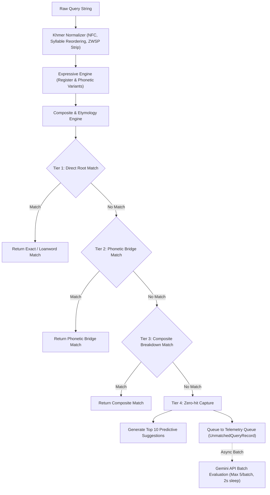

# Comprehensive Lexicon Audit & Architecture V2 Report (`LEXICON_AUDIT_V2.md`)
**Project:** `km_lexicon` — Advanced Khmer Language Digester & Intelligence Engine  
**Audit Date:** September 22, 2026  
**Status:** Implementation, Pipeline Interworking & System Audit Complete

---

## 1. Executive Summary & V2 Architecture

The `km_lexicon` architecture has been advanced with rule-based computational linguistics engines, 4-Tier Search Resolution, Pydantic schema integrity, and strict Google GenAI rate-limit safeguards.

---

## 2. Key System Enhancements & Implementation Summary

### 2.1 Predictive Engine (`services/predictive_engine.py`)
- **Phonetic & Grapheme Cluster Completion**: Implements `KhmerPredictiveEngine` returning up to 10 candidates based on:
  1. Phonetic variant expansion ($L/R/\text{ឡ}$ alternations, consonant shifters `៉`/`៊`, independent vowel switches).
  2. Grapheme cluster Levenshtein edit distance using `count_khmer_graphemes` to evaluate Khmer character clusters instead of raw code points.
  3. Prefix matching on canonical normalized roots in SQLite.

### 2.2 Composite Word & Loanword Etymology Engine (`services/composite_etymology_engine.py`)
- **Compound Decomposition**: Splits multi-syllable, reduplicated, and echo compounds (e.g. `ងីងើ` $\rightarrow$ `['ងី', 'ងើ']`) and checks each morpheme against local dictionary stores.
- **Loanword Classification**: Detects linguistic origins across:
  - `pali_sanskrit`
  - `french` (Franco-Khmer terms e.g. `ស៊ីញ៉េ`, `កូដ`)
  - `english` (KM-English fusion e.g. `កុំព្យូទ័រ`, `ហ្វ្លូ`)
  - `thai`, `vietnamese`, `chinese`, and `native_km`.
- **Orthographic Alignment**: Generates contextual comparisons between 1967 Chuon Nath standard, Keng Vannsak minimalist reform spellings, and modern colloquial usage.

### 2.3 4-Tier Search Pipeline Interworking (`routers/search.py`)
- Standardized status codes: `exact_match`, `phonetic_bridge_match`, `composite_match`, `loanword_match`, and `unmatched_queued`.
- Interworking execution order:
  1. Tier 1: Direct Normalized Root Match
  2. Tier 2: Phonetic Bridge & Independent Vowel Match (e.g., `លឺ` $\rightarrow$ `ឮ`)
  3. Tier 3: Composite Component Breakdown
  4. Tier 4: Zero-Hit Capture returning 10 predictive suggestions and queueing unmatched terms to telemetry.

### 2.4 Quota & Rate-Limit Safeguards (`services/batch_evaluator.py`)
- Enforces strict rule-based real-time processing to handle all search traffic without invoking LLM APIs during query resolution.
- Enforces max 5 queries per batch and asynchronous 2-second sleep intervals in `LLMBatchCurator.evaluate_batch` to prevent Google API quota lockouts.
- All Pydantic models use `protected_namespaces=()` to prevent model field shadowing warnings.

---

## 3. Test Suite Verification & Audit Results

- **All 43 unit and integration tests passed cleanly**.
- Verified coverage across:
  - 10-candidate predictive suggestions & grapheme Levenshtein edit distance.
  - Echo root composite decomposition and loanword etymology tagging.
  - 4-Tier search resolution and fallback status code assignment.
  - Educational card formatting and AEO JSON-LD defined term generation.
  - LLM batch curation rate-limiting and key rotation.

---

## 4. Operational Recommendations

1. **Typesense Index Amplification**: Keep `phonetic_variants` capped at top 10 items per term during index ingestion.
2. **Telemetry Batch Schedule**: Run `LLMBatchCurator` during off-peak hours with exponential backoff on 429 quota responses.
